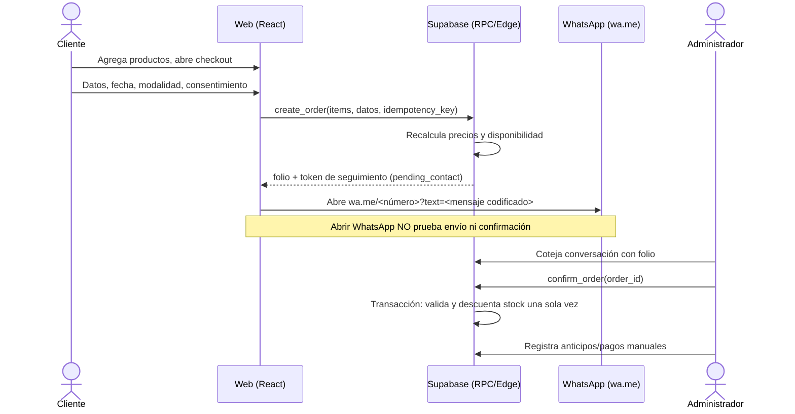
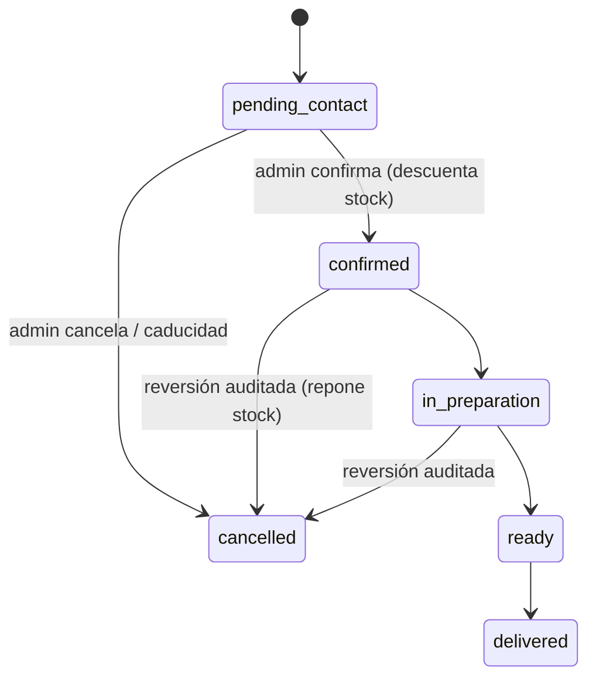

# Arquitectura — Pastelería Luchy (Fase 1)

> Nombre provisional. Documento complementario de `CLAUDE.md`; ante conflicto, prevalece `CLAUDE.md`.

## 1. MVP

Tienda de repostería en español (MX, MXN). El cliente navega, arma carrito y envía el pedido por WhatsApp (`wa.me`). La tienda confirma manualmente. **Sin pasarela de pagos**; anticipos/pagos se registran a mano por un administrador.

Dentro del MVP: catálogo (20 productos semilla, 5 categorías), búsqueda y filtros, detalle, carrito, checkout, folio, enlace WhatsApp, página de instrucciones, panel admin (productos, categorías, inventario, pedidos, pagos manuales, configuración).

Fuera: pago en línea, reparto en tiempo real, ERP de ingredientes, puntos, IA, cuentas de cliente, notificaciones automáticas por WhatsApp.

## 2. Flujo de compra

## 3. Estados del pedido

Estado de pago independiente: `unpaid`, `partial`, `paid`, `refunded`.

## 4. Modelo de datos orientativo

| Tabla | Notas |
|---|---|
| `profiles` | `user_id` → `auth.users`, `role`. Rol solo modificable por admin (sin autoasignación). |
| `categories`, `products`, `product_images` | `products`: SKU único, precio en centavos (`integer`), `allergens` administrable, `lead_time_hours`, `fulfillment_type` (`stock` / `made_to_order`), `active`. |
| `orders` | `id` uuid, `folio` legible, `public_token` aleatorio, `status`, `payment_status`, contacto mínimo, fecha solicitada, modalidad, `idempotency_key` único, `expires_at`. |
| `order_items` | Snapshot de nombre, SKU y precio unitario. |
| `inventory_movements` | Append-only: producto, delta, motivo, pedido, actor. |
| `payments` | Registro manual: monto, método, actor, nota. Sin datos de tarjeta. |
| `store_settings` | WhatsApp, nombre, horarios, cobertura, parámetros. Lectura pública solo de campos públicos. |

Reglas: dinero en centavos enteros; totales siempre calculados en BD; RLS en todas las tablas expuestas; la creación y confirmación de pedidos pasan por RPC `SECURITY DEFINER` con `search_path` fijo; el cliente anónimo no lee `orders` directamente.

## 5. Decisiones

| # | Decisión | Motivo |
|---|---|---|
| D1 | Carrito con **Zustand** + `persist` (solo `product_id`, cantidad, opciones) | Simple; precios se revalidan en backend, no se persisten como verdad. |
| D2 | Enrutado con **HashRouter** en GitHub Pages | Recargas y enlaces directos funcionan sin servidor. Alternativa: BrowserRouter + `404.html` de redirección; se reevalúa con dominio propio. Se confirma en Fase 3. |
| D3 | `/pedido/:folio` se consulta con **token aleatorio** (`?t=`), mostrando datos no sensibles | Evita enumerar folios secuenciales. |
| D4 | Precios en **centavos enteros** | Evita errores de punto flotante. |
| D5 | Productos `made_to_order` no descuentan stock físico; usan capacidad/anticipación | Política final pendiente (CLAUDE.md §14). |
| D6 | Idempotencia con `idempotency_key` generado en cliente, único en BD | Reintentos y doble clic no duplican pedidos. |
| D7 | Antispam: límite por IP en Edge Function + caducidad de pedidos no confirmados | A definir en Fase 6/9. Fase 4 añade un tope de 5 pedidos pendientes por teléfono y hora, y `expire_pending_orders()`. |
| D8 | El público lee productos solo por la vista `catalog_products` (disponibilidad booleana, sin cifra de stock) | No exponer inventario exacto; `products` queda solo para admin. |
| D9 | `stock_quantity` sin grant de escritura: solo cambia por RPC con movimiento auditado | Evita ajustes sin rastro y dobles descuentos. |
| D10 | `store_settings.timezone` por defecto `'UTC'`; la tienda (Piedras Negras, Coahuila) usa `America/Matamoros` | Define la fecha mínima de entrega en servidor y cliente. La ciudad la indicó la persona dueña del proyecto (2026-10-20); cobertura y horarios siguen pendientes (CLAUDE.md §14). |
| D11 | Semillas: pasteles y caja surtida `made_to_order`, el resto `stock` con 12 unidades | Suposición de demo; política real pendiente. |
| D12 | El panel `/admin` se carga bajo demanda (`React.lazy`) y envuelve su propia sesión (`AuthProvider` solo bajo `/admin`) | El sitio público no descarga código del panel ni abre sesiones. |
| D13 | Registro público de Auth desactivado; los administradores se crean a mano y su rol se inserta en `profiles` | No hay cuentas de cliente (CLAUDE.md §5); evita altas anónimas aunque RLS ya les niega todo. |
| D14 | Los productos y pagos nunca se borran: los productos se desactivan y los errores de pago se corrigen con un reembolso | Preserva historial y auditoría; `order_items` guarda snapshots. |
| D15 | `admin_dashboard()` agrega en el servidor ventas confirmadas, pagos netos, conteos por estado y stock bajo | La lógica de dinero no se calcula con filas traídas al navegador. |
| D16 | Pesos ↔ centavos con análisis de texto (`parsePesos`), nunca con flotantes; la UI solo captura/muestra pesos | CLAUDE.md §7: no confiar en cálculos JS para precios persistidos. |
| D18 | La personalización la declara cada producto (`allows_customization` + pista), no el tipo de entrega | Un pastel puede no admitirla y unas galletas sí; el servidor rechaza personalización donde no aplica. |
| D19 | Capacidad diaria = pedidos con productos bajo pedido por fecha solicitada; los pendientes no vencidos reservan cupo | Evita sobrevender mientras la tienda confirma. Aceptado por el propietario (2026-10-20). |
| D20 | `create_order` toma un `pg_advisory_xact_lock` por fecha cuando hay cupo limitado | Serializa los pedidos de un mismo día sin bloquear otras fechas; verificado con 3 pedidos simultáneos. |
| D21 | `get_availability` solo informa si un día está disponible y por qué, nunca cuántos pedidos hay; el detalle numérico es solo de `admin_capacity` | No exponer el volumen de ventas al público. |
| D22 | Valores por defecto neutros: capacidad sin límite, sin días cerrados, anticipación general 0 | No inventar reglas de negocio no definidas. Sustituido en parte por D23. |
| D23 | Política de la tienda: domingos sin recolección pero con entrega a domicilio (`pickup_closed_weekdays = {0}`), anticipación general 24 h | Decisión del propietario (2026-10-20); editable en el panel. |
| D25 | Límite por IP en `create_order` (10/h), `get_availability` (60/10 min) y `get_order_public` (60/10 min); la IP sale de `cf-connecting-ip` o de la **última** entrada de `x-forwarded-for` y se guarda como hash con sal en el esquema `private` | Verificado contra el proyecto real: el cliente puede anteponer valores a `x-forwarded-for`, pero Cloudflare rechaza un `cf-connecting-ip` falso. Las conexiones directas (pg_cron, SQL Editor) no tienen límite. Los reintentos idempotentes nunca se bloquean. |
| D26 | Las RPC públicas son envoltorios (`create_order` → `create_order_impl`, etc.) que aplican el límite y delegan; las implementaciones no son ejecutables desde la API | Evita duplicar la lógica y que alguien se salte el límite llamando a la implementación. |
| D27 | CSP estricta por `<meta>` en el build (`script-src 'self'`, `style-src 'self'`, sin `unsafe-inline`/`unsafe-eval`, `connect-src`/`img-src` solo al origen de Supabase) | GitHub Pages no permite cabeceras. `frame-ancestors` no funciona en `<meta>`: el panel se niega a mostrarse dentro de un iframe (clickjacking). |
| D28 | Suites que tocan el backend real (`test:db`, `test:concurrency`, `test:live`) exigen el proyecto de pruebas; las que escriben datos piden `LUCHY_ENTORNO=pruebas` y limpian todo al terminar | CLAUDE.md §12: nada destructivo contra producción. |
| D29 | Regresión de seguridad en pgTAP (`seguridad.test.sql`): lista cerrada de funciones ejecutables y privilegios de `anon`/`authenticated`, RLS en todas las tablas y `search_path` fijo en toda función privilegiada | Cualquier permiso de más en una migración futura rompe la prueba. |
| D30 | Dos proyectos Supabase: `luchy-pruebas` (datos ficticios, suites que escriben) y `luchy-produccion` (datos reales, solo lectura en humo); credenciales de producción en variables de usuario distintas | Que ninguna suite pueda escribir en producción por accidente (CLAUDE.md §12). |
| D31 | Producción se crea aplicando las migraciones con `db push --db-url` (sin `link` ni semillas) y la configuración de Auth con `config push --project-ref` | Se conserva el enlace al proyecto de pruebas para no tocar producción por error; las migraciones demostraron ser reproducibles desde cero. |
| D32 | Despliegue estático en GitHub Pages con `VITE_BASE=/<repositorio>/`, variables públicas del repositorio (no secretos) y humo posterior de solo lectura; el flujo se niega a publicar si falta la configuración o la clave no es la publicable | GitHub Pages no admite servidor ni cabeceras; el humo no crea pedidos en producción. |
| D33 | Respaldo lógico en JSON de los datos (`backup-datos`) y restauración solo sobre base vacía y en una transacción (`restaurar-datos`), probada borrando y restaurando la base de pruebas | El esquema vive en migraciones; el plan gratuito no incluye respaldos descargables. Los respaldos contienen datos personales: nunca se versionan. |
| D24 | `create_order` revisa la clave de idempotencia otra vez después del bloqueo por fecha | Un envío gemelo que esperó el bloqueo devuelve su pedido en vez de «sin cupo». |
| D17 | Imágenes de producto con ruta aleatoria (`products/<id>/<uuid>.<ext>`), MIME y 2 MB validados en cliente y en el bucket | No se conserva el nombre original; el servidor es la validación definitiva. |

## 6. Backlog por fase

| Fase | Criterios de aceptación clave |
|---|---|
| 2 UI/UX | Tokens de color/tipografía, prototipos móvil y escritorio, contraste AA. |
| 3 Técnica | Vite+TS strict+Tailwind, router, CI (lint, typecheck, test, build), Playwright con smoke test sin errores de consola. |
| 4 BD | Migraciones reproducibles, RLS, 20 semillas, pruebas SQL de acceso anónimo/cliente/admin. |
| 5 Catálogo | Home, filtros, búsqueda, detalle, imágenes demo marcadas como ejemplo. |
| 6 Carrito/WhatsApp | Totales del backend, idempotencia, URL y texto verificados sin enviar mensajes. |
| 7 Admin | Auth real con RLS, CRUD, inventario auditado, transiciones de estado, pagos manuales. |
| 8 Repostería | Personalización, anticipación mínima, fechas válidas/inválidas, capacidad. |
| 9 Seguridad | Auditoría Opus, pruebas de concurrencia (doble confirmación), regresión E2E. |
| 10 Publicación | GitHub Pages, smoke en URL pública, rutas directas, documentación. |

## 7. Plan E2E (ejecución pendiente hasta existir la app)

| ID | Escenario | Fase |
|---|---|---|
| E01 | Todas las rutas públicas cargan sin errores de consola; recarga en ruta profunda funciona | 3 |
| E02 | Búsqueda y filtro por categoría devuelven los productos esperados | 5 |
| E03 | Detalle muestra precio, disponibilidad, preparación | 5 |
| E04 | Carrito: cambiar cantidad, eliminar, persistir tras recarga, total estimado | 6 |
| E05 | Checkout: validaciones de campos, fecha y consentimiento | 6 |
| E06 | Crear pedido: folio mostrado; URL `wa.me` con número configurado y texto codificado correcto; no se envía nada | 6 |
| E07 | Doble envío con la misma `idempotency_key` crea un solo pedido | 6 |
| E08 | `/pedido/:folio` sin token válido no muestra datos | 6 |
| E09 | Anónimo no accede a `/admin`; usuario no admin no accede a datos de admin (verificado en BD) | 7 |
| E10 | Admin: CRUD de producto, movimiento de inventario, confirmar pedido descuenta stock una sola vez | 7 |
| E11 | Cancelar pedido confirmado repone stock y deja auditoría | 7 |
| E12 | Fecha por debajo de anticipación mínima es rechazada | 8 |

Pruebas aparte de Playwright: RLS (SQL), concurrencia en confirmación, y límites de tasa.

## 8. Riesgos y supuestos

- WhatsApp: abrir el enlace no confirma envío; el estado nunca avanza solo por eso.
- Cobertura, horarios, precios reales, número de WhatsApp y políticas: **pendientes** (CLAUDE.md §14); se usan placeholders configurables.
- GitHub Pages es estático: toda lógica sensible vive en Supabase.
- Cualquier cambio de RLS, dinero o stock requiere revisión Opus.
