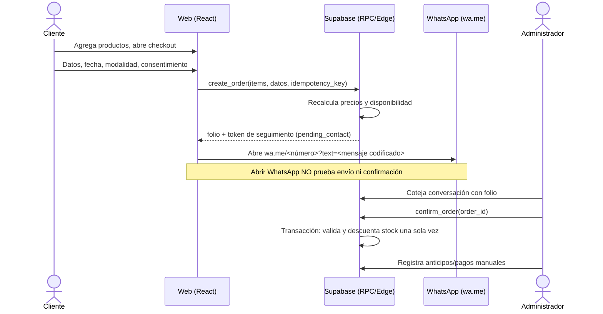
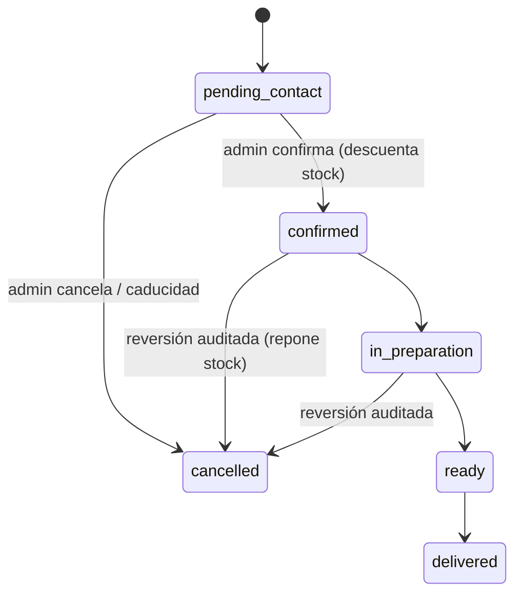

# Arquitectura — Pastelería Luchy (Fase 1)

> Nombre provisional. Documento complementario de `CLAUDE.md`; ante conflicto, prevalece `CLAUDE.md`.

## 1. MVP

Tienda de repostería en español (MX, MXN). El cliente navega, arma carrito y envía el pedido por WhatsApp (`wa.me`). La tienda confirma manualmente. **Sin pasarela de pagos**; anticipos/pagos se registran a mano por un administrador.

Dentro del MVP: catálogo (20 productos semilla, 5 categorías), búsqueda y filtros, detalle, carrito, checkout, folio, enlace WhatsApp, página de instrucciones, panel admin (productos, categorías, inventario, pedidos, pagos manuales, configuración).

Fuera: pago en línea, reparto en tiempo real, ERP de ingredientes, puntos, IA, cuentas de cliente, notificaciones automáticas por WhatsApp.

## 2. Flujo de compra

## 3. Estados del pedido

Estado de pago independiente: `unpaid`, `partial`, `paid`, `refunded`.

## 4. Modelo de datos orientativo

| Tabla | Notas |
|---|---|
| `profiles` | `user_id` → `auth.users`, `role`. Rol solo modificable por admin (sin autoasignación). |
| `categories`, `products`, `product_images` | `products`: SKU único, precio en centavos (`integer`), `allergens` administrable, `lead_time_hours`, `fulfillment_type` (`stock` / `made_to_order`), `active`. |
| `orders` | `id` uuid, `folio` legible, `public_token` aleatorio, `status`, `payment_status`, contacto mínimo, fecha solicitada, modalidad, `idempotency_key` único, `expires_at`. |
| `order_items` | Snapshot de nombre, SKU y precio unitario. |
| `inventory_movements` | Append-only: producto, delta, motivo, pedido, actor. |
| `payments` | Registro manual: monto, método, actor, nota. Sin datos de tarjeta. |
| `store_settings` | WhatsApp, nombre, horarios, cobertura, parámetros. Lectura pública solo de campos públicos. |

Reglas: dinero en centavos enteros; totales siempre calculados en BD; RLS en todas las tablas expuestas; la creación y confirmación de pedidos pasan por RPC `SECURITY DEFINER` con `search_path` fijo; el cliente anónimo no lee `orders` directamente.

## 5. Decisiones

| # | Decisión | Motivo |
|---|---|---|
| D1 | Carrito con **Zustand** + `persist` (solo `product_id`, cantidad, opciones) | Simple; precios se revalidan en backend, no se persisten como verdad. |
| D2 | Enrutado con **HashRouter** en GitHub Pages | Recargas y enlaces directos funcionan sin servidor. Alternativa: BrowserRouter + `404.html` de redirección; se reevalúa con dominio propio. Se confirma en Fase 3. |
| D3 | `/pedido/:folio` se consulta con **token aleatorio** (`?t=`), mostrando datos no sensibles | Evita enumerar folios secuenciales. |
| D4 | Precios en **centavos enteros** | Evita errores de punto flotante. |
| D5 | Productos `made_to_order` no descuentan stock físico; usan capacidad/anticipación | Política final pendiente (CLAUDE.md §14). |
| D6 | Idempotencia con `idempotency_key` generado en cliente, único en BD | Reintentos y doble clic no duplican pedidos. |
| D7 | Antispam: límite por IP en Edge Function + caducidad de pedidos no confirmados | A definir en Fase 6/9. Fase 4 añade un tope de 5 pedidos pendientes por teléfono y hora, y `expire_pending_orders()`. |
| D8 | El público lee productos solo por la vista `catalog_products` (disponibilidad booleana, sin cifra de stock) | No exponer inventario exacto; `products` queda solo para admin. |
| D9 | `stock_quantity` sin grant de escritura: solo cambia por RPC con movimiento auditado | Evita ajustes sin rastro y dobles descuentos. |
| D10 | `store_settings.timezone = 'UTC'` como valor neutro | Zona horaria pendiente (CLAUDE.md §14); afecta el cálculo de fecha mínima. |
| D11 | Semillas: pasteles y caja surtida `made_to_order`, el resto `stock` con 12 unidades | Suposición de demo; política real pendiente. |

## 6. Backlog por fase

| Fase | Criterios de aceptación clave |
|---|---|
| 2 UI/UX | Tokens de color/tipografía, prototipos móvil y escritorio, contraste AA. |
| 3 Técnica | Vite+TS strict+Tailwind, router, CI (lint, typecheck, test, build), Playwright con smoke test sin errores de consola. |
| 4 BD | Migraciones reproducibles, RLS, 20 semillas, pruebas SQL de acceso anónimo/cliente/admin. |
| 5 Catálogo | Home, filtros, búsqueda, detalle, imágenes demo marcadas como ejemplo. |
| 6 Carrito/WhatsApp | Totales del backend, idempotencia, URL y texto verificados sin enviar mensajes. |
| 7 Admin | Auth real con RLS, CRUD, inventario auditado, transiciones de estado, pagos manuales. |
| 8 Repostería | Personalización, anticipación mínima, fechas válidas/inválidas, capacidad. |
| 9 Seguridad | Auditoría Opus, pruebas de concurrencia (doble confirmación), regresión E2E. |
| 10 Publicación | GitHub Pages, smoke en URL pública, rutas directas, documentación. |

## 7. Plan E2E (ejecución pendiente hasta existir la app)

| ID | Escenario | Fase |
|---|---|---|
| E01 | Todas las rutas públicas cargan sin errores de consola; recarga en ruta profunda funciona | 3 |
| E02 | Búsqueda y filtro por categoría devuelven los productos esperados | 5 |
| E03 | Detalle muestra precio, disponibilidad, preparación | 5 |
| E04 | Carrito: cambiar cantidad, eliminar, persistir tras recarga, total estimado | 6 |
| E05 | Checkout: validaciones de campos, fecha y consentimiento | 6 |
| E06 | Crear pedido: folio mostrado; URL `wa.me` con número configurado y texto codificado correcto; no se envía nada | 6 |
| E07 | Doble envío con la misma `idempotency_key` crea un solo pedido | 6 |
| E08 | `/pedido/:folio` sin token válido no muestra datos | 6 |
| E09 | Anónimo no accede a `/admin`; usuario no admin no accede a datos de admin (verificado en BD) | 7 |
| E10 | Admin: CRUD de producto, movimiento de inventario, confirmar pedido descuenta stock una sola vez | 7 |
| E11 | Cancelar pedido confirmado repone stock y deja auditoría | 7 |
| E12 | Fecha por debajo de anticipación mínima es rechazada | 8 |

Pruebas aparte de Playwright: RLS (SQL), concurrencia en confirmación, y límites de tasa.

## 8. Riesgos y supuestos

- WhatsApp: abrir el enlace no confirma envío; el estado nunca avanza solo por eso.
- Cobertura, horarios, precios reales, número de WhatsApp y políticas: **pendientes** (CLAUDE.md §14); se usan placeholders configurables.
- GitHub Pages es estático: toda lógica sensible vive en Supabase.
- Cualquier cambio de RLS, dinero o stock requiere revisión Opus.
